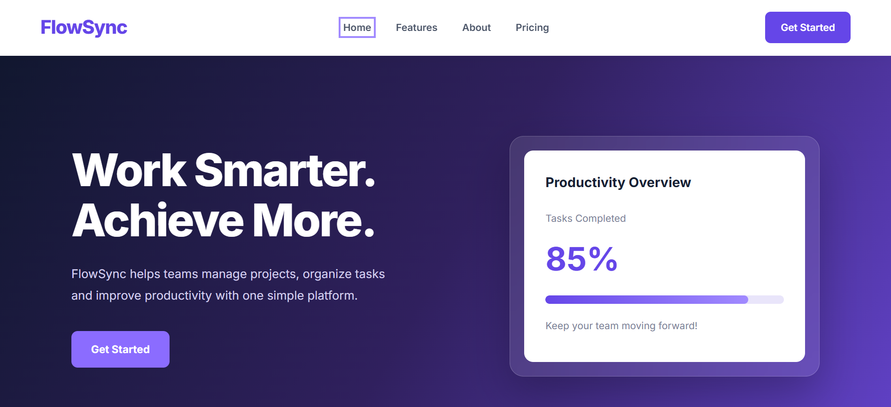
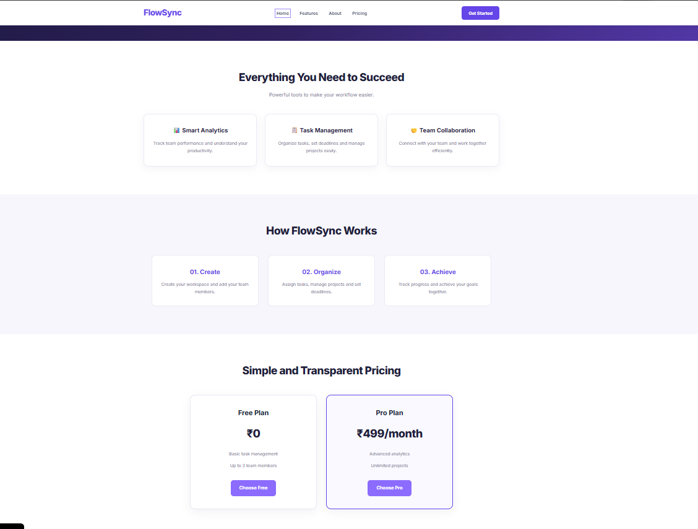
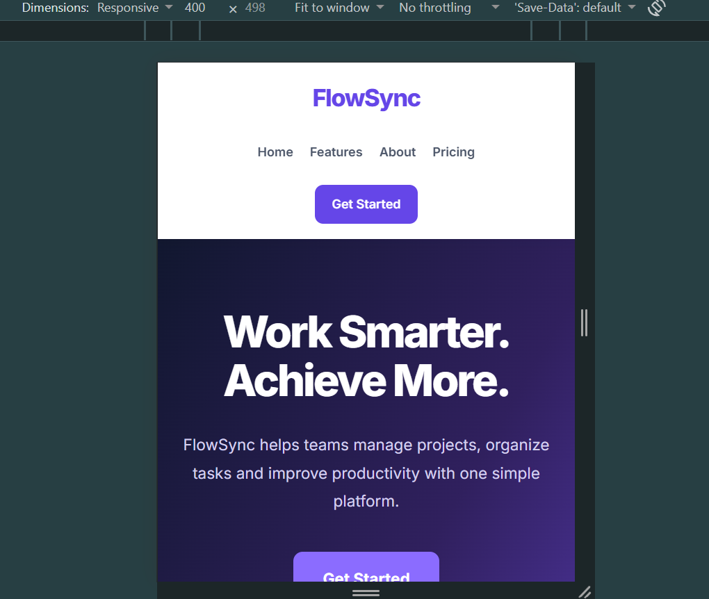

# FlowSync – SaaS Productivity Landing Page

## Project Overview

FlowSync is a modern, responsive landing page for a fictional AI-powered productivity platform. It helps individuals and teams manage tasks, monitor productivity, and collaborate efficiently.

Developed as part of the Sankar Group Front-End Development Internship Assignment.

## Features

- Responsive navigation bar with section links.
- Modern hero section with call-to-action buttons.
- Three productivity feature sections.
- About and How It Works sections.
- Free and Pro pricing plans.
- Interactive pricing plan selection.
- Contact form with JavaScript validation.
- Success message after valid submission.
- Responsive desktop, tablet and mobile layouts.

## Technologies Used

- HTML5
- CSS3
- JavaScript
- Google Fonts

## Project Structure

```text
flowsync-saas-landing-page/
│
├── index.html
├── style.css
├── script.js
├── README.md
├── desktop-home.png
├── desktop-sections.png
└── mobile-view.png
```

## Screenshots

### Desktop Homepage



### Desktop Features and Pricing



### Mobile Responsive View



## How to Run Locally

1. Clone or download this repository.
2. Open the project folder in Visual Studio Code.
3. Open index.html in Google Chrome.

You can also use the VS Code Live Server extension.

## Form Functionality

The contact form validates the user's name and email address using JavaScript and displays a success message after valid submission.

Note: This is a front-end demonstration. Form submissions are not stored or sent to a backend server.

## Live Demo

https://aditi2515.github.io/flowsync-saas-landing-page/

## Author

Sankar Group Front-End Development Internship Assignment